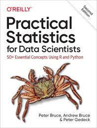

# Practical Statistics for Data Scientists - Chapters 1-4

This is my summarizations for the book:
Four original, self-contained notebooks based on Chapters 1-4 of *Practical Statistics for Data Scientists* (2nd ed.) by Peter Bruce, Andrew Bruce, and Peter Gedeck.

In this repo, I try to summarize and try to understand the concepts that are in this book as a task to complete my subject which is Deep Learning.

Content:

| Folder | Notebook | Main topics |
|---|---|---|
| `Chapter1_Exploratory_Data_Analysis` | `chapter1.ipynb` | data structure, descriptive summaries, distributions, relationships |
| `Chapter2_Data_and_Sampling_Distributions` | `chapter2.ipynb` | sampling, bias, bootstrap, intervals, probability distributions |
| `Chapter3_Statistical_Experiments_and_Significance_Testing` | `chapter3.ipynb` | A/B testing, permutations, p-values, multiple tests, bandits, power |
| `Chapter4_Regression_and_Prediction` | `chapter4.ipynb` | regression, validation, factors, intervals, diagnostics, nonlinearity |

## Reference

Bruce, P., Bruce, A., & Gedeck, P. (2020). *Practical Statistics for Data Scientists: 50+ Essential Concepts Using R and Python* (2nd ed.). O'Reilly Media.

